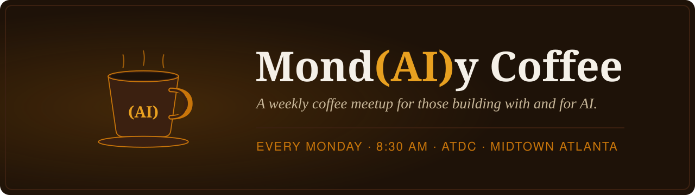

  

  <a href="https://mondaiycoffee.com/"><b>Website</b></a> ·
  <a href="https://mondaiycoffee.com/about/">About</a> ·
  <a href="https://mondaiycoffee.com/notes/">Meeting notes</a> ·
  <a href="https://mondaiycoffee.com/members/">Members</a> ·
  <a href="https://mondaiycoffee.com/speak/">Speak</a>

---

**Mond(AI)y Coffee** is a free weekly meetup for AI builders, founders, researchers, and the curious in Atlanta. We meet every Monday morning at [ATDC](https://atdc.org/) in Midtown. No RSVP, no pitch decks. Bring coffee, a question, or something you built.

### ☕ Come by

| | |
|---|---|
| **When** | Every Monday, 8:30am |
| **Where** | ATDC, Midtown Atlanta |
| **Cost** | Free, no RSVP required |

### 🎤 Get involved

- **Present something.** Read the [speaker page](https://mondaiycoffee.com/speak/). If you use an AI assistant, point it at our [pre-read guide](https://mondaiycoffee.com/pre-read.md) and it will interview you and draft your pre-read.
- **Get listed.** Regulars can add a profile to the [members directory](https://mondaiycoffee.com/members/).
- **Improve the site.** It's a Hugo site in [`website-main`](https://github.com/Mond-AI-y-Coffee/website-main), and pull requests are welcome.

### 📬 Contact

Questions or ideas: [Adam.Gautsch@atdc.org](mailto:Adam.Gautsch@atdc.org)
